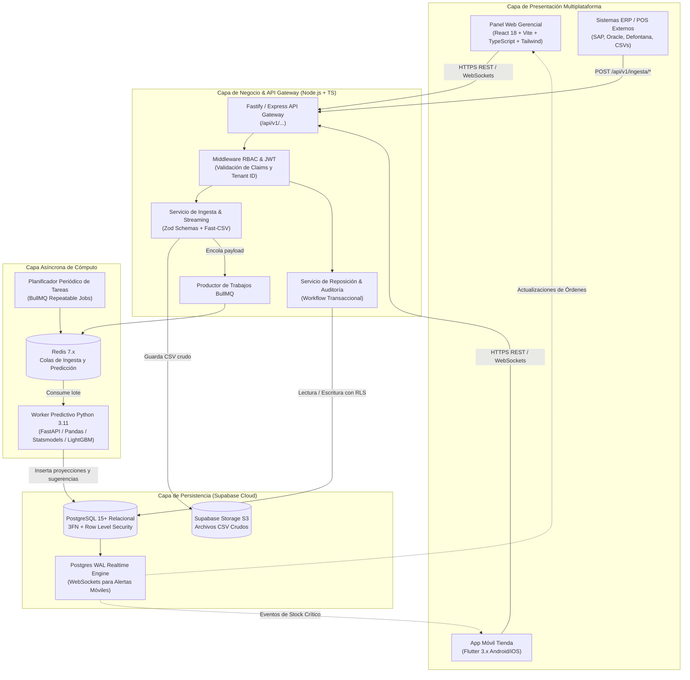

# Arquitectura del Sistema (ARCHITECTURE)
## SportStockAI — Plataforma SaaS B2B de Optimización de Inventario y Analítica Predictiva

---

## 1. Visión General de la Arquitectura

SportStockAI implementa el patrón **Modular Monolith con Worker Predictivo Asíncrono**. Esta arquitectura equilibra la simplicidad operativa requerida para un equipo técnico lean (evitando la sobrecarga de microservicios distribuidos) con el desacoplamiento necesario para procesar cálculos estadísticos de series de tiempo sin degradar la API transaccional.



---

## 2. Definición de Capas y Responsabilidades

### 2.1. Capa de Presentación
- **Panel Web Ejecutivo (Gerentes de Operaciones y TI)**:
  - Tecnologías: React 18, Vite, TypeScript, Tailwind CSS, Shadcn UI.
  - Componentes clave: `@tanstack/react-table` para grillas densas de SKUs con ordenamiento y filtros multi-columna; `Recharts` / `Apache ECharts` para curvas de demanda histórica vs. proyectada; exportador a XLSX/PDF.
- **Aplicación Móvil de Tienda (Encargados de Inventario)**:
  - Tecnologías: Flutter (Dart) para Android e iOS.
  - Componentes clave: `mobile_scanner` para lectura de códigos de barra y QR; `flutter_bloc` / `riverpod` para reactividad; sincronización de stock crítico en vivo vía WebSockets.

### 2.2. Capa de Negocio y API Gateway
- Tecnologías: Node.js (v20 LTS), Fastify o Express con TypeScript en modo estricto.
- Responsabilidades:
  - Enrutamiento RESTful bajo `/api/v1/`.
  - Autenticación mediante JWT y resolución de contexto multi-tenant (`cadena_id`).
  - Validación de esquemas en tiempo de ejecución con **Zod**.
  - Publicación de trabajos pesados en colas de Redis.

### 2.3. Capa Asíncrona y Motor Predictivo
- Tecnologías: Python 3.11, Redis, BullMQ / Celery.
- Bibliotecas analíticas: `pandas`, `numpy`, `statsmodels` (modelos Holt-Winters y descomposición estacional), `lightgbm` para calibración con factores exógenos (disciplinas, eventos deportivos, lead times).
- Modos de ejecución:
  - **Batch Nocturno/Semanal**: Recalcula curvas de demanda de las 2 a 8 semanas siguientes para todas las sucursales.
  - **Bajo Demanda (On-Demand)**: Disparado cuando se aprueba una ingesta masiva de ventas.

### 2.4. Capa de Persistencia y Multi-Tenancy
- Motor: PostgreSQL administrado en Supabase Cloud.
- Todas las tablas implementan Tercera Forma Normal (3FN).
- **Aislamiento Multi-Tenancy**: Cada tabla incluye `cadena_id`. Las políticas de RLS garantizan aislamiento a nivel de motor de base de datos.
- **Optimización de Series Temporales**: Particionado por rango mensual en `ventas_historicas` con índices BRIN sobre la columna `fecha`.

---

## 3. Modelo de Datos Relacional (3FN)

```sql
-- 1. Cadenas Clientes (Tenants)
CREATE TABLE cadenas (
    id UUID PRIMARY KEY DEFAULT gen_random_uuid(),
    nombre VARCHAR(150) NOT NULL,
    rut VARCHAR(20) NOT NULL UNIQUE,
    tier VARCHAR(20) NOT NULL CHECK (tier IN ('TIER_1', 'TIER_2')),
    moneda VARCHAR(3) DEFAULT 'USD',
    creado_en TIMESTAMPTZ DEFAULT NOW()
);

-- 2. Sucursales
CREATE TABLE sucursales (
    id UUID PRIMARY KEY DEFAULT gen_random_uuid(),
    cadena_id UUID NOT NULL REFERENCES cadenas(id) ON DELETE CASCADE,
    codigo VARCHAR(50) NOT NULL,
    nombre VARCHAR(150) NOT NULL,
    direccion TEXT,
    lead_time_dias INT NOT NULL DEFAULT 3,
    creado_en TIMESTAMPTZ DEFAULT NOW(),
    UNIQUE(cadena_id, codigo)
);

-- 3. Usuarios y Roles (RBAC)
CREATE TABLE usuarios (
    id UUID PRIMARY KEY DEFAULT gen_random_uuid(),
    cadena_id UUID NOT NULL REFERENCES cadenas(id) ON DELETE CASCADE,
    sucursal_id UUID REFERENCES sucursales(id) ON DELETE SET NULL,
    email VARCHAR(255) NOT NULL UNIQUE,
    rol VARCHAR(30) NOT NULL CHECK (rol IN ('ADMIN_TI', 'GERENTE_OPERACIONES', 'ENCARGADO_TIENDA')),
    activo BOOLEAN DEFAULT TRUE,
    creado_en TIMESTAMPTZ DEFAULT NOW()
);

-- 4. Catálogo Maestro de Productos
CREATE TABLE productos_sku (
    id UUID PRIMARY KEY DEFAULT gen_random_uuid(),
    cadena_id UUID NOT NULL REFERENCES cadenas(id) ON DELETE CASCADE,
    sku_codigo VARCHAR(100) NOT NULL,
    nombre VARCHAR(255) NOT NULL,
    disciplina VARCHAR(50) NOT NULL CHECK (disciplina IN ('FUTBOL', 'RUNNING', 'FITNESS', 'TRAIL', 'OUTDOOR', 'OTRO')),
    precio_costo NUMERIC(12,2) NOT NULL DEFAULT 0,
    precio_venta NUMERIC(12,2) NOT NULL DEFAULT 0,
    creado_en TIMESTAMPTZ DEFAULT NOW(),
    UNIQUE(cadena_id, sku_codigo)
);

-- 5. Inventario en Tienda en Tiempo Real
CREATE TABLE inventario_tienda (
    id UUID PRIMARY KEY DEFAULT gen_random_uuid(),
    cadena_id UUID NOT NULL REFERENCES cadenas(id) ON DELETE CASCADE,
    sucursal_id UUID NOT NULL REFERENCES sucursales(id) ON DELETE CASCADE,
    sku_id UUID NOT NULL REFERENCES productos_sku(id) ON DELETE CASCADE,
    stock_actual INT NOT NULL CHECK (stock_actual >= 0),
    stock_minimo INT NOT NULL DEFAULT 5,
    stock_seguridad INT NOT NULL DEFAULT 3,
    stock_transito INT NOT NULL DEFAULT 0,
    actualizado_en TIMESTAMPTZ DEFAULT NOW(),
    UNIQUE(sucursal_id, sku_id)
);

-- 6. Historial de Ventas (Particionado por Fecha)
CREATE TABLE ventas_historicas (
    id UUID NOT NULL DEFAULT gen_random_uuid(),
    cadena_id UUID NOT NULL REFERENCES cadenas(id) ON DELETE CASCADE,
    sucursal_id UUID NOT NULL REFERENCES sucursales(id) ON DELETE CASCADE,
    sku_id UUID NOT NULL REFERENCES productos_sku(id) ON DELETE CASCADE,
    fecha DATE NOT NULL,
    unidades INT NOT NULL CHECK (unidades > 0),
    total_monto NUMERIC(12,2) NOT NULL,
    creado_en TIMESTAMPTZ DEFAULT NOW(),
    PRIMARY KEY (id, fecha)
) PARTITION BY RANGE (fecha);

CREATE INDEX idx_ventas_fecha_brin ON ventas_historicas USING BRIN (fecha);
CREATE INDEX idx_ventas_sku_sucursal ON ventas_historicas (cadena_id, sucursal_id, sku_id);

-- 7. Proyecciones Predictivas de Demanda
CREATE TABLE proyecciones_demanda (
    id UUID PRIMARY KEY DEFAULT gen_random_uuid(),
    cadena_id UUID NOT NULL REFERENCES cadenas(id) ON DELETE CASCADE,
    sucursal_id UUID NOT NULL REFERENCES sucursales(id) ON DELETE CASCADE,
    sku_id UUID NOT NULL REFERENCES productos_sku(id) ON DELETE CASCADE,
    semana_inicio DATE NOT NULL,
    horizonte_semana INT NOT NULL CHECK (horizonte_semana BETWEEN 1 AND 8),
    demanda_proyectada INT NOT NULL,
    limite_inferior INT,
    limite_superior INT,
    factor_estacional NUMERIC(5,3) DEFAULT 1.000,
    generado_en TIMESTAMPTZ DEFAULT NOW()
);

-- 8. Órdenes y Sugerencias de Reposición
CREATE TABLE ordenes_reposicion (
    id UUID PRIMARY KEY DEFAULT gen_random_uuid(),
    cadena_id UUID NOT NULL REFERENCES cadenas(id) ON DELETE CASCADE,
    sucursal_id UUID NOT NULL REFERENCES sucursales(id) ON DELETE CASCADE,
    sku_id UUID NOT NULL REFERENCES productos_sku(id) ON DELETE CASCADE,
    cantidad_sugerida INT NOT NULL,
    cantidad_aprobada INT,
    fecha_pedido_sugerida DATE NOT NULL,
    estado VARCHAR(30) NOT NULL DEFAULT 'PENDIENTE' CHECK (estado IN ('PENDIENTE', 'APROBADA', 'RECHAZADA', 'EN_TRANSITO', 'RECIBIDA')),
    aprobado_por UUID REFERENCES usuarios(id),
    resuelto_en TIMESTAMPTZ,
    creado_en TIMESTAMPTZ DEFAULT NOW()
);
```

---

## 4. Contratos de Comunicación API REST

Todos los endpoints responden utilizando la estructura canónica:
```json
{
  "success": true,
  "data": { ... },
  "error": null,
  "meta": {
    "timestamp": "2026-11-22T21:00:00Z",
    "trace_id": "req-98fbc12a"
  }
}
```

### Endpoints Principales:
1. `POST /api/v1/ingesta/lote`
   - **Auth**: `ADMIN_TI`
   - **Payload**: Multipart CSV o JSON con ventas e inventario.
   - **Respuesta**: `202 Accepted` + `{ "job_id": "job_abc123", "status": "QUEUED" }`.
2. `GET /api/v1/ingesta/lote/:job_id`
   - **Auth**: `ADMIN_TI`
   - **Respuesta**: `200 OK` + estado del lote, filas procesadas y array de filas rechazadas con errores.
3. `POST /api/v1/predicciones/ejecutar`
   - **Auth**: `GERENTE_OPERACIONES`, `ADMIN_TI`
   - **Payload**: `{ "sucursal_id": "...", "horizonte_semanas": 4 }`
   - **Respuesta**: `202 Accepted` + `{ "prediction_job_id": "pred_456" }`.
4. `GET /api/v1/dashboard/resumen`
   - **Auth**: `GERENTE_OPERACIONES`
   - **Query Params**: `?sucursal_id=...&disciplina=RUNNING&horizonte=4`
   - **Respuesta**: `200 OK` con métricas, curvas históricas vs. estimadas y órdenes pendientes.
5. `PATCH /api/v1/ordenes/:id/estado`
   - **Auth**: `GERENTE_OPERACIONES`
   - **Payload**: `{ "estado": "APROBADA", "cantidad_aprobada": 25 }`
   - **Respuesta**: `200 OK` con la orden actualizada y log de auditoría.
6. `POST /api/v1/tienda/venta`
   - **Auth**: `ENCARGADO_TIENDA`
   - **Payload**: `{ "sku_id": "...", "unidades": 2 }`
   - **Respuesta**: `200 OK` con saldo actualizado y disparo de alerta si entra en umbral crítico.
