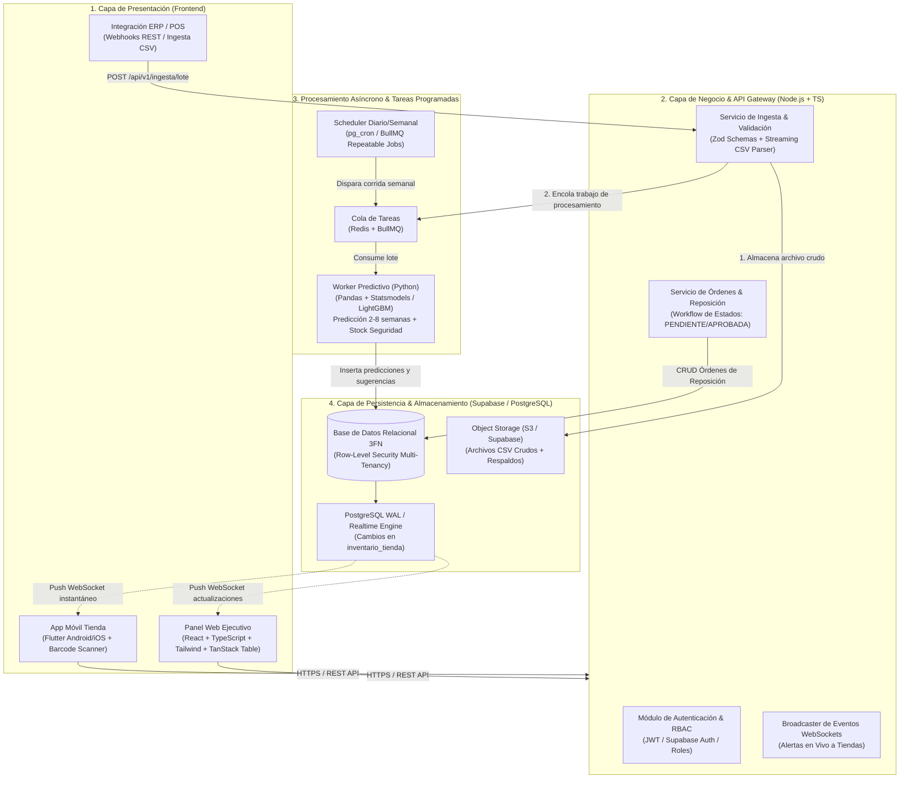

# Evaluación Estratégica de Stack Tecnológico y Arquitectura de Software
## Proyecto: SportStockAI — Plataforma SaaS B2B de Optimización de Inventario y Analítica Predictiva

**Autores del Proyecto:** Irían López, Matías Muñoz, Gonzalo Rivera / Renato Núñez, Jorge Hormazábal, Joyce Honores  
**Institución:** Universidad San Sebastián (Santiago, Chile) — Asignaturas: *Formulación y Evaluación de Proyectos (FEP)* y *Taller de Ingeniería de Software*  
**Fecha:** Noviembre de 2026  
**Documento:** Informe Técnico de Arquitectura y Evaluación Tecnológica (Versión 1.0)

---

## 1. Resumen Ejecutivo

El proyecto **SportStockAI** es una solución SaaS B2B concebida para abordar una ineficiencia crítica en el sector de retail deportivo: **la pérdida de hasta un 12% en ventas estacionales debido a quiebres de stock** y la **inmovilización innecesaria de capital de trabajo** en inventario de baja rotación, provocada por la falta de herramientas analíticas predictivas especializadas y la dependencia de planillas manuales (visibilidad evaluada en 2,2/5,0 por los decisores).

La evaluación económica desarrollada en los Avances N° 1, 2 y 3 demuestra una alta rentabilidad y solidez financiera (VAN puro a 5 años de **$114.289.981 CLP**, TIR de **58,76%**, recuperación de capital en **3,01 años** y un **91,51% de probabilidad de éxito** en simulación de Montecarlo). Sin embargo, el análisis técnico y de mercado identifica tensiones arquitectónicas entre el prototipo académico inicial de 4 semanas y la escala comercial requerida para atender a más de 15 cadenas regionales (264 sucursales proyectadas al Año 5 en Chile, Perú y Colombia).

El presente documento evalúa exhaustivamente el stack tecnológico base planteado en los documentos y formula una **arquitectura óptima, modular y escalable**, diseñada para maximizar el rendimiento, desacoplar el procesamiento intensivo de series temporales, garantizar el aislamiento multi-inquilino (*multi-tenancy*), cumplir con la normativa chilena de protección de datos personales (**Ley N° 21.719**) y permitir una evolución sin fricciones para un equipo técnico lean de 4 desarrolladores.

---

## 2. Diagnóstico del Estado Actual del Proyecto

### 2.1. Hallazgos del Negocio y del Estudio de Mercado
- **Validación del Problema**: En la encuesta realizada a 10 decisores reales de retail deportivo, el 70% declaró sufrir quiebres de stock de forma "frecuente o permanente" en temporadas pico, y el 70% estima que pierde más del 5% de sus ventas anuales por este motivo.
- **Disposición de Pago (WTP)**: La mediana observada fue de **USD 150 / sucursal / mes**, lo que valida el precio propuesto para el segmento Tier 1 (USD 150/sucursal/mes) y el plan corporativo Tier 2 (USD 1.200/mes para cadenas de >10 sucursales).
- **Alerta de Concentración de Mercado**: En Chile solo existen dos grandes cadenas deportivas con más de 10 sucursales (*Decathlon* y *Sparta*). La meta comercial de alcanzar 15 cadenas Tier 2 exige obligatoriamente:
  1. Captar cadenas medianas locales (Tier 1 de 3 a 10 sucursales).
  2. Habilitar la comercialización regional en **Perú y Colombia** a partir del Año 2.
- **Factor Decisorio de Compra**: La **integración con el ERP actual** (SAP, Oracle, ERPs locales) fue calificada como el atributo prioritario número 1 (40% de las preferencias), superando al precio (20%). Por ende, la arquitectura debe garantizar tiempos de onboarding e integración API inferiores a 15 días hábiles.

### 2.2. Requisitos Técnicos y Atributos de Calidad Comprometidos
- **RNF-01 (Seguridad y Privacidad)**: Control de acceso basado en roles (RBAC: Gerente, Tienda, Admin TI), comunicación cifrada de extremo a extremo mediante TLS 1.3 y estricto cumplimiento de la Ley N° 21.719 sobre tratamiento de datos personales.
- **RNF-02 (Rendimiento y Latencia)**: Procesamiento y emisión de pronósticos para lotes de 500 SKUs en un tiempo inferior a 3 segundos.
- **RNF-03 (Usabilidad Multiplataforma)**: Visualización gerencial densa y analítica para escritorio, y aplicación móvil ágil con semáforos de stock para piso de tienda.
- **Capacidad del Sistema**: El diseño preliminar en Supabase Large soporta un máximo de 150 sucursales (capacidad real de 120 sucursales con holgura del 80%). Al mes 18, la demanda proyectada (180 sucursales) sobrepasa dicha capacidad, obligando a prever la partición y el escalamiento desde el mes 12.

---

## 3. Evaluación Crítica del Stack Tecnológico

A continuación se analizan las tecnologías propuestas originalmente frente a las mejores alternativas de la industria para cada capa del sistema:

### 3.1. Capa de Presentación (Frontend Web y Móvil)
- **Propuesta Original**: Flutter unificado tanto para la aplicación Web como para la aplicación Móvil.
- **Evaluación Crítica**:
  - *Flutter en Móvil (Android/iOS)*: **Altamente recomendado**. Para el encargado de inventario en tienda, Flutter ofrece un rendimiento nativo fluido (60-120 fps), excelente integración con hardware (cámara, lectores de código de barra/QR de mano) y soporte offline robusto cuando la conectividad en pasillos de bodega es inestable.
  - *Flutter en Web (Dashboard Gerencial)*: **Desaconsejado para producción**. Flutter Web renderiza mediante CanvasKit/WebAssembly (WASM). Aunque visualmente consistente, genera:
    1. *Tiempos de carga inicial elevados* (bundle inicial de varios megabytes).
    2. *Dificultades en manipulación de datos tabulares masivos*: Los gerentes de retail requieren tablas dinámicas complejas (filtros multicriterio por disciplina, ordenamiento por rotación, edición in-place, selección y copiado de texto nativo), aspectos donde el DOM HTML nativo es ampliamente superior.
    3. *Incompatibilidad con herramientas auxiliares*: Extensiones de navegador (gestores de contraseñas, traductores, lectores de pantalla).
- **Veredicto Recomendado**: 
  - **Móvil**: Mantener **Flutter** para la App de Tienda.
  - **Web**: Desarrollar el Panel Web Gerencial en **React (Vite o Next.js) con TypeScript, Tailwind CSS y componentes Shadcn UI**. Integrar `@tanstack/react-table` para tablas analíticas masivas y `Recharts` o `Apache ECharts` para curvas de estacionalidad.

### 3.2. Capa de Lógica de Negocio y API Gateway
- **Propuesta Original**: Node.js con Express en JavaScript tradicional.
- **Evaluación Crítica**:
  - Node.js es ideal para manejar concurrencia de I/O, procesamiento de payloads JSON y comunicación con bases de datos relacionales con un consumo mínimo de memoria.
  - Sin embargo, utilizar JavaScript sin tipado en un sistema B2B con múltiples contratos (integraciones ERP, cargas CSV, respuestas API) aumenta exponencialmente la probabilidad de errores en tiempo de ejecución.
  - **Riesgo de Bloqueo del Event Loop**: Alojar el cálculo predictivo de cientos de series temporales en el mismo hilo de ejecución de Express causará degradación de latencia o congelamiento de la API mientras se calculan las predicciones semanales.
- **Veredicto Recomendado**: 
  - Adoptar **Node.js con TypeScript**.
  - Migrar o estructurar la API sobre **Fastify** o **Express modular** con validación de esquemas en tiempo de ejecución usando **Zod**. Zod valida automáticamente tanto payloads de ERPs como archivos CSV, rechazando datos corruptos antes de tocar la base de datos.

### 3.3. Motor de Analítica Predictiva y Machine Learning
- **Propuesta Original**: Cálculo algorítmico de demanda programado en Node.js mediante suavizamiento exponencial e índices deterministas.
- **Evaluación Crítica**:
  - Para el prototipo de 4 semanas (MVP académico), programar un suavizamiento exponencial simple en TypeScript es viable.
  - Sin embargo, para un producto comercial B2B en retail deportivo que debe considerar factores exógenos (fechas FIFA, campeonatos de fútbol, temporadas escolares, clima, lead times de importación de proveedores), el ecosistema de Node.js carece de bibliotecas científicas optimizadas con vectorización C/C++.
- **Veredicto Recomendado**: 
  - Para la versión de producción, desacoplar el motor predictivo en un **Worker de Cómputo en Python** (utilizando `FastAPI`, `Pandas`, `Statsmodels` y `LightGBM`). 
  - Este servicio se ejecuta de forma asíncrona mediante una cola de trabajo, ejecutando cálculos batch sin afectar la navegación de los usuarios en el dashboard.

### 3.4. Capa de Persistencia y Multi-Tenancy (Base de Datos)
- **Propuesta Original**: Supabase Cloud (PostgreSQL relacional normalizado en 3FN).
- **Evaluación Crítica**:
  - **Excelente decisión**. PostgreSQL es el motor relacional por excelencia para consistencia transaccional ACID, fundamental cuando se manejan inventarios y órdenes de compra.
  - Proporciona **Row Level Security (RLS)** nativo para garantizar un estricto aislamiento multi-inquilino (*multi-tenancy*), de modo que cada cadena deportiva solo tenga acceso a sus registros sin riesgo de fuga de datos entre competidores (por ejemplo, entre Sparta y Marathon).
  - Incluye **Supabase Realtime Engine** (basado en WebSockets de Postgres WAL), que permite actualizar automáticamente el stock en las aplicaciones móviles de las tiendas tras cada venta.
- **Optimizaciones Requeridas**:
  - La tabla `ventas_historicas` acumula millones de registros a lo largo del tiempo. Se recomienda aplicar **particionado nativo por rango de fechas** (mensual o trimestral) e indexación **BRIN** (*Block Range Index*) para la columna `fecha`, reduciendo el uso de memoria RAM en más de un 70% comparado con índices B-Tree estándar.

### 3.5. Capa de Tareas en Segundo Plano (*Job Queue*)
- **Propuesta Original**: No considerada explícitamente en el diseño base (las peticiones de ingesta y predicción se contemplaban síncronas).
- **Evaluación Crítica**:
  - La ingesta de archivos CSV masivos (5.000 a 50.000 filas) y el cálculo de reposiciones no deben resolverse en el ciclo síncrono HTTP `Request-Response` (riesgo inminente de *Gateway Timeout 504*).
- **Veredicto Recomendado**:
  - Incorporar una cola de tareas basada en **Redis con BullMQ** (o alternativamente **pg-boss** utilizando la misma base PostgreSQL en fases tempranas). La API responde inmediatamente `202 Accepted` con un identificador de seguimiento (`job_id`), procesando el archivo en background.

---

## 4. Arquitectura de Software Óptima Recomendada

Se propone una arquitectura de **Monolito Modular con Workers de Cómputo Asíncronos** (*Modular Monolith + Background Workers*), evitando la complejidad prematura de microservicios distribuidos pero garantizando el desacoplamiento entre operaciones transaccionales y analítica pesada.

### 4.1. Diagrama de Arquitectura del Sistema



---

### 4.2. Modelo de Datos Relacional y Estrategia Multi-Inquilino

El modelo implementa aislamiento lógico mediante `cadena_id` (Tenant ID) y políticas RLS obligatorias en todas las entidades:

```
┌─────────────────────────────────────────────────────────────────────────────┐
│                            ENTIDADES DEL SISTEMA                             │
├─────────────────────────────────────────────────────────────────────────────┤
│ 1. cadenas          (id PK, nombre, rut, tier, config_json)                 │
│ 2. usuarios         (id PK, cadena_id FK, email, rol, sucursal_id FK)       │
│ 3. sucursales       (id PK, cadena_id FK, codigo, nombre, lead_time_dias)   │
│ 4. productos_sku    (id PK, cadena_id FK, sku_codigo, nombre, disciplina,   │
│                      precio_costo, precio_venta)                            │
│ 5. inventario_tienda(id PK, sucursal_id FK, sku_id FK, stock_actual,        │
│                      stock_seguridad, punto_reorden, actualizado_en)        │
│ 6. ventas_historicas(id PK, sucursal_id FK, sku_id FK, fecha, unidades,     │
│                      precio_unitario) [Particionada por fecha]              │
│ 7. proyecciones_dem (id PK, sucursal_id FK, sku_id FK, fecha_semana,       │
│                      demanda_estimada, limite_inferior, limite_superior)    │
│ 8. ordenes_reposic  (id PK, sucursal_id FK, sku_id FK, cantidad_sugerida,   │
│                      cantidad_aprobada, estado, fecha_pedido, aprobado_por) │
└─────────────────────────────────────────────────────────────────────────────┘
```

#### Regla de Seguridad Multi-Inquilino (RLS):
```sql
-- Ejemplo de Política RLS en PostgreSQL para aislamiento total:
ALTER TABLE inventario_tienda ENABLE ROW LEVEL SECURITY;

CREATE POLICY tenant_isolation_policy ON inventario_tienda
    FOR ALL
    USING (cadena_id = current_setting('app.current_cadena_id')::uuid);
```

---

### 4.3. Contratos de Comunicación API REST

| Método | Endpoint | Rol de Acceso | Descripción Funcional |
| :--- | :--- | :--- | :--- |
| `POST` | `/api/v1/ingesta/lote` | Admin TI | Recibe lote JSON o multipart CSV. Valida formato con Zod, responde `202 Accepted` y encola procesamiento. |
| `GET` | `/api/v1/ingesta/lote/:job_id` | Admin TI | Consulta estado del lote (En cola, Procesando, Completado con errores, Validado). |
| `POST` | `/api/v1/predicciones/ejecutar` | Gerente / Admin | Dispara manualmente la corrida del modelo predictivo para una sucursal o disciplina específica. |
| `GET` | `/api/v1/dashboard/resumen` | Gerente Operaciones | Retorna KPIs consolidados, alertas activas y comparativa entre demanda histórica y curva proyectada (2–8 semanas). |
| `PATCH`| `/api/v1/ordenes/:id/estado` | Gerente Operaciones | Transición de estado de orden (`PENDIENTE` $\to$ `APROBADA` o `RECHAZADA`), registrando auditoría. |
| `POST` | `/api/v1/tienda/venta` | Encargado Tienda | Descuenta `stock_actual` al instante tras una venta local y dispara alerta inmediata si cruza el umbral crítico. |

---

## 5. Matriz Comparativa: Stack Original vs. Stack Óptimo

| Dimensión | Stack Base (Documentos) | Stack Óptimo Recomendado | Impacto en el Proyecto |
| :--- | :--- | :--- | :--- |
| **UX Web Escritorio** | Flutter Web (WASM/CanvasKit) | **React + Vite / Next.js (HTML5 / DOM)** | Carga en <1s, selección nativa, tablas analíticas fluidas y menor consumo de RAM. |
| **Robustez Backend** | Express con JavaScript | **Fastify / Express con TypeScript + Zod** | Cero errores de tipado, validación estricta de esquemas y documentación OpenAPI automática. |
| **Capacidad Analítica** | Cálculo en Node.js | **Worker Asíncrono en Python + BullMQ** | Soporta modelos ML complejos, no bloquea peticiones de usuarios y escala horizontalmente. |
| **Ingesta de Datos** | Síncrona (Riesgo de timeout) | **Asíncrona desacoplada con Cola Redis** | Permite ingestas masivas de ERPs sin caídas de conexión HTTP. |
| **Aislamiento B2B** | Lógica en Backend | **PostgreSQL Row-Level Security (RLS)** | Garantía criptográfica y relacional de separación de datos por cliente. Cumple Ley 21.719. |

---

## 6. Estrategia de Mitigación de Riesgos Técnicos

1. **Riesgo de Superar la Capacidad de Base de Datos en Mes 18 (180 sucursales)**:
   - *Mitigación*: En lugar de migrar prematuramente a esquemas múltiples o fragmentación compleja (*sharding*), optimizar consultas con índices BRIN en `ventas_historicas`, implementar particionado mensual e incorporar un caché en Redis (TTL 15 min) para dashboards gerenciales. Esto multiplica por 4 la capacidad sostenida de un plan Supabase Pro/Large.
2. **Riesgo de Integración Heterogénea con ERPs (SAP, Oracle, Softland, Defontana)**:
   - *Mitigación*: Implementación del estándar de "Ingesta Dual": conectores API REST para clientes modernos y parseador tolerante a fallos para cargas masivas en formato CSV/Excel para cadenas que aún operan con sistemas legados o planillas.
3. **Riesgo de Bloqueo Regulatorio por Ley N° 21.719 (Protección de Datos Personales)**:
   - *Mitigación*: Separación estricta entre datos transaccionales de venta e información personal de clientes finales (deportistas). El SaaS solo procesa SKUs, volúmenes, fechas y sucursales, minimizando el almacenamiento de datos sensibles del consumidor final y firmando contratos de encargo de tratamiento con las cadenas.

---

## 7. Plan de Transición y Roadmap Pragmático de Ejecución

Para conciliar la entrega inmediata del prototipo funcional académico y la construcción del producto comercial B2B, se establece un plan en dos fases:

```
FASE 1: PROTOTIPO FUNCIONAL (Avance 2 Taller Software / Meses 1 a 3)
┌────────────────────────────────────────────────────────────────────────┐
│ • Mantener Flutter compartido (Web + Móvil) para validar la maqueta    │
│   funcional en el plazo de 4 semanas fijado por la cátedra.           │
│ • Implementar Backend en Node.js/Express con TypeScript y Supabase.    │
│ • Ejecutar el suavizamiento exponencial determinista en Node.js sobre  │
│   el dataset sintético acotado.                                        │
│ • Demostrar el flujo end-to-end: CSV -> Predicción -> Aprobación.      │
└───────────────────────────────────┬────────────────────────────────────┘
                                    │
                                    ▼
FASE 2: ESCALAMIENTO INDUSTRIAL Y COMERCIAL (Meses 4 a 18 / Lanzamiento)
┌────────────────────────────────────────────────────────────────────────┐
│ • Bifurcación del Frontend: Construir el Panel Web Gerencial definitivo│
│   en React + Tailwind + TanStack Table; consolidar Flutter en móvil.   │
│ • Extraer el motor predictivo a un Worker en Python (FastAPI/Pandas).  │
│ • Integrar Redis + BullMQ para ingesta asíncrona de archivos masivos.  │
│ • Activar RLS estricto y auditorías de seguridad para venta corporativa│
│   a cadenas Tier 1 y Tier 2 en Chile, Perú y Colombia.                 │
└────────────────────────────────────────────────────────────────────────┘
```

---

## 8. Conclusión

El proyecto **SportStockAI** posee fundamentos económicos y comerciales sólidos, respaldados por una necesidad latente en el retail deportivo y una alta disposición de pago. 

La arquitectura recomendada (Frontend Web en **React**, App Móvil en **Flutter**, Backend API en **Node.js/TypeScript**, persistencia con **Supabase PostgreSQL RLS** y motor predictivo asíncrono en **Python con BullMQ**) resuelve los cuellos de botella detectados en los documentos originales, preserva la viabilidad operativa para un equipo técnico de 4 ingenieros y sienta las bases para escalar de manera robusta y rentable en América Latina.
